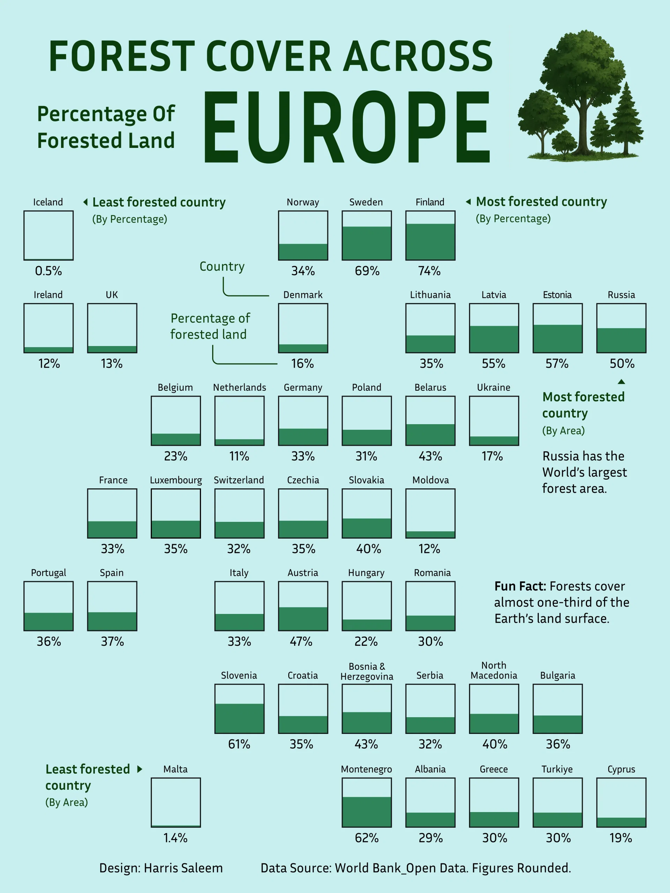

Reaching net zero by 2050 takes more than switching to renewable energy. We also need to stop adding carbon to the atmosphere faster than natural systems can absorb it. Forests and land play a central part in that, and they are under growing pressure.

---

### Why forests matter for the climate

Forests matter for biodiversity, and they are also one of the planet's main ways of absorbing CO2. In a typical year, forests and other vegetation absorb roughly **30%** of the carbon humans emit from burning fossil fuels. That is a large buffer, and one we tend to take for granted.

How much carbon a tree stores depends on several things:

- **Age**: the longer a tree lives, the more carbon it holds
- **Growth stage**: younger trees absorb carbon faster; older trees slow down but hold more
- **Species**: different trees have different wood density and growth rates
- **Size**: larger trees generally store more carbon
- **Soil type**: affects growth rate and long-term health

What happens when a tree dies matters too. Its carbon is gradually released back into the soil or the atmosphere. Trees cut for timber keep their carbon locked up until the wood starts to break down. Trees burned for fuel release it straight away. So how we manage forests makes a real difference, as well as whether we plant them.

---

### Diversity makes forests more effective

A large international study covering 273 forests, 243 species and 255 plantations around the world found that mixed forests clearly do better than monocultures. Trees planted alongside at least one other species grow around 5% taller and nearly 7% wider, and capture up to **25% more carbon** than single-species forests. They are also healthier overall and produce more biomass. This matters for conservation, and for any reforestation or afforestation programme that aims to store as much carbon as possible.

---

### The situation is getting worse

Despite their importance, forests are getting weaker as a carbon sink. In 2023 and 2024, extreme fires meant forests absorbed only around a quarter of the carbon they take up in an average year. That is a big drop, and it is more than a one-off. It is part of a longer trend in which the gap between the carbon forests absorb and the carbon they release is narrowing.

The 2024 figures are especially worrying:

- 6.7 million hectares of primary rainforest were lost, nearly double the 2023 figure
- That is the equivalent of 18 football pitches every minute
- Forest loss in 2024 alone caused 3.1 gigatonnes of greenhouse gas emissions, roughly equal to India's annual fossil fuel emissions

Brazil accounted for **42%** of all primary rainforest loss in the tropics. Bolivia ranked second for the first time, with primary forest loss nearly five times higher than in 2020. In the Democratic Republic of Congo and Congo-Brazzaville, the loss of untouched rainforest reached record levels.

At COP26 in Glasgow, more than 140 world leaders pledged to halt deforestation by 2030. On current trends, meeting that target would need forest loss to fall by 20% a year from 2024 levels. Countries are not on track.

---

### From carbon sink to carbon source

This is already happening. Some forests now release more carbon than they absorb. If that spreads, one of the planet's most important natural climate buffers will start working against us.

The clearest priority is to protect the forests that already exist. Old-growth and **primary forests** store far more carbon than replanted or managed forests, and they cannot be replaced on any timescale that matters to us. Reforestation and afforestation are valuable, but they do not replace protection.

---

### A note on timber and construction

Forests can also help cut emissions from construction. Timber used instead of concrete and steel keeps its carbon locked up for the lifetime of the building. This link between land management and the built environment is part of the full picture of what forests contribute.

---

### Forest cover across Europe

While the global picture is one of loss, Europe is an exception. According to the State of Europe's Forests 2025 report and World Bank data, European forest area has generally grown over the last three decades. Sustainable forestry policies, reforestation programmes and natural regrowth on abandoned farmland are behind this.

Finland leads Europe by a wide margin, with roughly **73%** of its land covered by forest. Sweden is close behind, and Montenegro and Slovenia also rank near the top. At the other end, Iceland, Ireland and the UK have some of the lowest forest shares on the continent. Ireland's low forest cover reflects centuries of intensive farming and the lack of a major reforestation tradition until recent decades.

More forest area does not automatically mean healthier forests, though. The European Environment Agency notes that forest resilience is becoming a policy concern as temperatures rise and extreme weather becomes more frequent. Logging, insect outbreaks, drought and storm damage are all increasing. Europe's forests are growing in total area, but under growing pressure.

<!-- tag: ireland -->
Ireland also has a rare kind of forest that few people know about: **temperate rainforest**, which only grows where rain falls on more than 200 days a year. It once covered much of the west of Ireland. Today less than 2% of the country is native woodland, and only fragments of this rainforest remain. The charity Hometree is working with farmers and landowners to restore 4,000 acres along the west coast, as the first phase of a ten-year plan covering 57,500 acres ([Hometree](../sources/hometree-rainforest-fundraiser-2026.md)).

---

### Who protects forests, and who pays for it

Over 8 million hectares of forest of all kinds were lost worldwide in 2024, and nearly 490 million hectares have gone since 1990. The trend can turn: deforestation in Brazil's Amazon fell by 41% between August 2025 and 2026, to its lowest rate since records began ([DW](../sources/tfff-funding-gap-dw-2026.md)).

Much of what remains is looked after by the people who live in it. Indigenous Peoples and local communities hold or manage lands with **54% of the world's remaining intact forests**, and these lands often lose less forest than land run by governments or companies. That work carries real danger: at least 124 land and environmental defenders were killed worldwide in 2025, 26 of them in Brazil. Money still flows the wrong way. UNEP estimates that $7.3 trillion went into activities harming nature in 2023, against $220 billion for nature-based solutions, more than 30 to 1 ([WRI](../sources/community-forest-economies-wri-2026.md)).

One attempt to change the maths is the Tropical Forest Forever Facility, launched at [COP30](../legislation-policy/COP30.md). It would pay countries $4 a year for every hectare of tropical forest they keep standing, checked by satellite, with at least 20% going to Indigenous peoples and local communities. By November 2026 it had $7.9 billion of the $10 billion in starting capital it needs by the end of the year ([DW](../sources/tfff-funding-gap-dw-2026.md)).

---

Forests are doing essential work for the climate, and that work is being undermined faster than most people realise. Land management is central to climate policy, not a side issue.
# Sources
- WRI. https://www.wri.org/insights/forest-carbon-sink-shrinking-fires-deforestation
- The Guardian, 21 May 2025. https://www.theguardian.com/environment/2025/may/21/fires-record-loss-forests-global-heating-agriculture-logging-brazil-bolivia-aoe
- Global Forest Watch. https://research.wri.org/gfr/global-forest-review
- DW, Jeannette Cwienk, 13 November 2026. https://www.dw.com/en/could-lack-of-money-sink-tfff-rainforest-fund-before-it-even-launches/a-79878673
- World Resources Institute, Wanjira Mathai, November 2026. https://www.wri.org/insights/community-led-forest-communities-economy
- Hometree, Rainforest Fundraiser, November 2026. https://www.hometree.ie/fundraiser
- Visual Capitalist, Srijaa Chatterjee, 10 June 2026. https://www.visualcapitalist.com/cp/europes-most-forested-countries/
